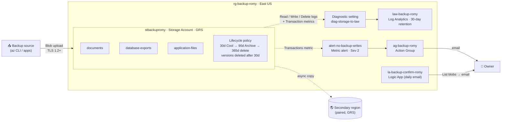

# 💾 Azure Automated Backup System


> **A backup system that runs itself:** geo-replicated blob storage, versioning, cost-saving lifecycle tiers, and a monitoring alert that fires when backups stop landing. Built with Terraform.

🎥 **Walkthrough video:** [Watch me!](https://drive.google.com/file/d/1tprYxLdgeBI31JmSVrLh1ARK0VjAWk3j/view?usp=drive_link)

---

## 📋 At a Glance

| | |
|---|---|
| **Cloud** | Microsoft Azure |
| **Region** | East US (secondary region paired automatically by GRS) |
| **IaC** | Terraform, AzureRM provider `~> 5.0.0` (lock file pins `5.0.1`) |
| **Resources managed** | 12 |
| **Core services** | Blob Storage (GRS), Lifecycle Management, Log Analytics, Azure Monitor, Logic Apps |
| **Est. time** | 3-4 hours |
| **Difficulty** | Beginner |

---

## 📑 Table of Contents

1. [Objective](#1--objective)
2. [Architecture](#2--architecture)
3. [Key Concepts](#3--key-concepts)
4. [Design Decisions](#4--design-decisions)
5. [Prerequisites](#5--prerequisites)
6. [Project Structure and Naming](#6--project-structure-and-naming)
7. [The Terraform Code](#7--the-terraform-code)
8. [Deployment](#8--deployment)
9. [Configure the Daily Confirmation Email](#9--configure-the-daily-confirmation-email)
10. [Validation](#10--validation)
11. [Troubleshooting](#11--troubleshooting)
12. [Clean Up](#12--clean-up)
13. [Key Takeaways and Next Steps](#13--key-takeaways-and-next-steps)

---

## 1. 🎯 Objective

### The problem

For many small businesses, "backup" means someone occasionally copying files to an external drive. When that person is away or forgets, nothing gets backed up, and when something goes wrong the data is simply gone.

### The solution

Replace the manual process with a system that:

- 🌍 **Replicates every file** to a second Azure region automatically (GRS)
- 🕰️ **Keeps every version** of every file, so overwrites and deletes can be undone
- 💰 **Controls cost** by moving older data to Cool after 30 days and Archive after 90, then deleting after 365
- 🔔 **Alerts when backups stop** arriving, so silence is never mistaken for success
- 📧 **Confirms daily** by email that the system is alive (Logic App, configured in the portal)

---

## 2. 🏗️ Architecture



### Resource map

```
rg-backup-romy
├── stbackupromy                      Storage Account (GRS, TLS 1.2, versioning on)
│   ├── documents                     Container (private)
│   ├── database-exports              Container (private)
│   ├── application-files             Container (private)
│   ├── backup-lifecycle              Management policy (tiering + version cleanup)
│   └── RBAC: Storage Blob Data Contributor on documents → deploying user
├── law-backup-romy                   Log Analytics workspace
├── diag-storage-to-law               Diagnostic setting (blob service → workspace)
├── ag-backup-romy                    Action group (email receiver)
├── alert-no-backup-writes            Metric alert (no successful writes in 24h)
└── la-backup-confirm-romy            Logic App workflow (empty shell, designed in portal)
```

---

## 3. 🧠 Key Concepts

| Concept | Plain-English meaning |
|---|---|
| **GRS (Geo-Redundant Storage)** | Data is kept in the primary region and copied asynchronously to a paired secondary region. If a whole region fails, a copy survives. LRS only protects within one region. |
| **Blob versioning** | Every overwrite or delete keeps the previous version. You can restore a file to an earlier point. |
| **Soft delete** | Deleted blobs and containers stay recoverable for 30 days before permanent removal. A second safety net on top of versioning. |
| **Lifecycle management** | Rules that move or delete blobs by age, so you do not pay Hot prices for data nobody reads. |
| **Access tiers** | Hot (frequent), Cool (occasional), Archive (rarely read, cheapest to store, slowest and costliest to read). |
| **Diagnostic setting** | Routes a resource's logs and metrics to a destination such as Log Analytics. |
| **Metric alert** | Evaluates a platform metric on a schedule and notifies an action group when a condition is met. |
| **Action group** | The "who gets notified, and how" object that alerts point to. |

### How the version rule behaves

The lifecycle `version` action deletes each **individual version** 30 days after *that version* was created. It does not look at the current blob's age, and it never deletes the current blob.

```text
Base blob:      V1 created Jan 1 ---- overwritten Jan 10
                                  |
Versions:       V1 countdown: Jan 1 + 30 days -> delete Jan 31
                                  |
                V2 created Jan 10 + 30 days -> delete Feb 9
```

Scope comes from the rule's **filters** (here, the three container prefixes), not from the action itself.

---

## 4. 🧩 Design Decisions

| Decision | Reasoning | Trade-off |
|---|---|---|
| **GRS replication** | A backup that lives in one region is not a real backup. | Roughly double the storage cost of LRS. |
| **Versioning plus 30-day soft delete** | Protects against both overwrites and deletes. | Versions consume storage until the lifecycle rule cleans them up. |
| **Three containers by data type** | Under pressure, restoring from a clearly named container beats searching a mixed pile. | Slightly more to manage. |
| **All containers `private`** | Backup data should never be publicly readable. | Access needs an identity or key. |
| **TLS 1.2 minimum** | Older TLS versions have known weaknesses. | Very old clients cannot connect. |
| **30 / 90 / 365-day tiering** | Cool after 30d, Archive after 90d, delete after 365d balances cost against recoverability. | Archive blobs must be rehydrated before reading (hours). |
| **Delete old versions after 30 days** | Matches the soft-delete window and stops unbounded growth. | Anything older than 30 days is recoverable only if it is the current blob. |
| **Alert on successful `PutBlob`/`PutBlock` only** | Filtering on `ApiName` and `ResponseType = Success` means reads and failed writes do not hide a stopped backup. | Backup tools that upload with other APIs (for example `PutBlockList`-only flows) would not be counted. |
| **Role assignment scoped to the `documents` container** | Lets the deploying user upload with `--auth-mode login` (Entra ID) instead of account keys. | Only `documents` is writable this way; the other containers need their own assignment. |
| **Logic App created empty in Terraform** | The workflow definition (trigger and connectors) is built in the designer. | The daily email is **not** reproducible from this code alone. |

---

## 5. ✅ Prerequisites

- Azure subscription (Contributor plus the ability to create role assignments)
- [Terraform](https://developer.hashicorp.com/terraform/install) 1.x
- [Azure CLI](https://aka.ms/installazurecliwindows), signed in with `az login`
- An Office 365 Outlook account for the Logic App email step
- Git

```powershell
az login
az account set --subscription "<your-subscription-name-or-id>"
terraform --version
```

---

## 6. 📁 Project Structure and Naming

```
azure-data-backup/
├── main.tf              # All resources
├── variables.tf         # yourname, location, alert_email, tags
├── outputs.tf           # Storage name, connection string (sensitive), LAW id, Logic App endpoint
├── terraform.tfvars     # Your values (keep out of Git)
└── .terraform.lock.hcl  # Provider version lock
```

### Variables

| Variable | Default | Purpose |
|---|---|---|
| `yourname` | none (required) | Lowercase, no spaces; makes names unique |
| `location` | `East US` | Azure region |
| `alert_email` | none (required) | Recipient for alerts and the daily email |
| `tags` | `project=backup-system`, `environment=dev`, `managed_by=terraform` | Applied to taggable resources |

### Naming (with `yourname = "romy"`)

| Resource | Name |
|---|---|
| Resource group | `rg-backup-romy` |
| Storage account | `stbackupromy` |
| Containers | `documents`, `database-exports`, `application-files` |
| Lifecycle rule | `backup-lifecycle` |
| Log Analytics workspace | `law-backup-romy` |
| Diagnostic setting | `diag-storage-to-law` |
| Action group | `ag-backup-romy` (short name `backupalert`) |
| Logic App | `la-backup-confirm-romy` |
| Metric alert | `alert-no-backup-writes` |

> 💡 Storage account names must be globally unique, 3-24 characters, lowercase letters and digits only.

### 🔐 Keep these out of Git

`terraform.tfvars` (contains your email), `terraform.tfstate`, `terraform.tfstate.backup`, and `.terraform/` hold personal data or sensitive values. Add them to `.gitignore` before your first commit:

```gitignore
.terraform/
*.tfstate
*.tfstate.*
*.tfvars
```

---

## 7. 🧱 The Terraform Code

<details>
<summary><b>variables.tf</b></summary>

```hcl
variable "yourname" {
  description = "Your name, lowercase, no spaces. Used to make resource names unique."
  type        = string
}

variable "location" {
  type    = string
  default = "East US"
}

variable "alert_email" {
  description = "Email address to receive daily backup confirmation."
  type        = string
}

variable "tags" {
  type = map(string)
  default = {
    project     = "backup-system"
    environment = "dev"
    managed_by  = "terraform"
  }
}
```

</details>

<details>
<summary><b>terraform.tfvars</b> (example values, use your own)</summary>

```hcl
yourname    = "romy"
location    = "East US"
alert_email = "you@example.com"
```

</details>

<details>
<summary><b>main.tf</b></summary>

```hcl
terraform {
  required_providers {
    azurerm = {
      source  = "hashicorp/azurerm"
      version = "~> 5.0.0"
    }
  }
}

provider "azurerm" {
  features {}
}

data "azurerm_client_config" "current" {}


# Resource groups
resource "azurerm_resource_group" "main" {
  name     = "rg-backup-${var.yourname}"
  location = var.location
  tags     = var.tags
}

# RBAC role to allow the current user to upload to the documents container
resource "azurerm_role_assignment" "backup_test_uploader" {
  scope                = "${azurerm_storage_account.backup.id}/blobServices/default/containers/documents"
  role_definition_name = "Storage Blob Data Contributor"
  principal_id         = data.azurerm_client_config.current.object_id
}

# Blob storage
resource "azurerm_storage_account" "backup" {
  name                     = "stbackup${var.yourname}"
  resource_group_name      = azurerm_resource_group.main.name
  location                 = var.location
  account_tier             = "Standard"
  account_replication_type = "GRS"
  min_tls_version          = "TLS1_2"

  blob_properties {
    versioning_enabled = true

    delete_retention_policy {
      days = 30
    }

    container_delete_retention_policy {
      days = 30
    }
  }

  tags = var.tags
}

# Storage containers
resource "azurerm_storage_container" "documents" {
  name                  = "documents"
  storage_account_id    = azurerm_storage_account.backup.id
  container_access_type = "private"

}

resource "azurerm_storage_container" "database_exports" {
  name                  = "database-exports"
  storage_account_id    = azurerm_storage_account.backup.id
  container_access_type = "private"
}

resource "azurerm_storage_container" "application_files" {
  name                  = "application-files"
  storage_account_id    = azurerm_storage_account.backup.id
  container_access_type = "private"
}

# Data lifecycle policies
resource "azurerm_storage_management_policy" "lifecycle" {
  storage_account_id = azurerm_storage_account.backup.id

  rule {
    name    = "backup-lifecycle"
    enabled = true

    filters {
      blob_types   = ["blockBlob"]
      prefix_match = ["documents/", "database-exports/", "application-files/"]
    }

    actions {
      base_blob {
        tier_to_cool_after_days_since_modification_greater_than    = 30
        tier_to_archive_after_days_since_modification_greater_than = 90
        delete_after_days_since_modification_greater_than          = 365
      }

      version {
        delete_after_days_since_creation = 30
      }
    }
  }
}

# Log analytics workspace 
resource "azurerm_log_analytics_workspace" "main" {
  name                = "law-backup-${var.yourname}"
  location            = var.location
  resource_group_name = azurerm_resource_group.main.name
  sku                 = "PerGB2018"
  retention_in_days   = 30
  tags                = var.tags
}

# Log analytics workspace settings to collect diagnostics and logs
resource "azurerm_monitor_diagnostic_setting" "storage_logs" {
  name                       = "diag-storage-to-law"
  target_resource_id         = "${azurerm_storage_account.backup.id}/blobServices/default"
  log_analytics_workspace_id = azurerm_log_analytics_workspace.main.id

  enabled_log { category = "StorageRead" }
  enabled_log { category = "StorageWrite" }
  enabled_log { category = "StorageDelete" }

  enabled_metric {
    category = "Transaction"
  }
}

# Action group and Logic app for automated backup notifications
resource "azurerm_monitor_action_group" "backup_alerts" {
  name                = "ag-backup-${var.yourname}"
  resource_group_name = azurerm_resource_group.main.name
  short_name          = "backupalert"

  email_receiver {
    name                    = "owner-email"
    email_address           = var.alert_email
    use_common_alert_schema = true
  }

  tags = var.tags
}

resource "azurerm_logic_app_workflow" "backup_confirmation" {
  name                = "la-backup-confirm-${var.yourname}"
  location            = var.location
  resource_group_name = azurerm_resource_group.main.name
  tags                = var.tags
}

# Monitor alerting 
resource "azurerm_monitor_metric_alert" "no_writes" {
  name                = "alert-no-backup-writes"
  resource_group_name = azurerm_resource_group.main.name
  scopes              = [azurerm_storage_account.backup.id]
  description         = "Fires if no files have been written to backup storage in 24 hours."
  severity            = 2
  frequency           = "PT1H"
  window_size         = "P1D"

  criteria {
    metric_namespace = "Microsoft.Storage/storageAccounts"
    metric_name      = "Transactions"
    aggregation      = "Total"
    operator         = "LessThan"
    threshold        = 1

    dimension {
      name     = "ApiName"
      operator = "Include"
      values   = ["PutBlob", "PutBlock"]
    }

    dimension {
      name     = "ResponseType"
      operator = "Include"
      values   = ["Success"]
    }
  }

  action {
    action_group_id = azurerm_monitor_action_group.backup_alerts.id
  }

  tags = var.tags
}
```

</details>

<details>
<summary><b>outputs.tf</b></summary>

```hcl
output "storage_account_name" {
  value = azurerm_storage_account.backup.name
}

output "storage_account_connection_string" {
  value     = azurerm_storage_account.backup.primary_connection_string
  sensitive = true
}

output "log_analytics_workspace_id" {
  value = azurerm_log_analytics_workspace.main.id
}

output "logic_app_endpoint" {
  value = azurerm_logic_app_workflow.backup_confirmation.access_endpoint
}
```

</details>

### Notes on the code

- **AzureRM 5.x syntax:** containers use `storage_account_id` (not `storage_account_name`) and the diagnostic setting uses `enabled_metric` (not `metric`). Older tutorials using AzureRM 3.x syntax will not validate against this provider version.
- **Dependency order:** the role assignment references the storage account, so Terraform creates the account first even though the block appears earlier in the file.
- **Sensitive output:** `storage_account_connection_string` is marked `sensitive`, so it is hidden in normal output. Retrieve it with `terraform output -raw storage_account_connection_string`.

---

## 8. 🚀 Deployment

```powershell
cd azure-data-backup

terraform init
terraform validate
terraform plan
terraform apply
```

Expect **12 resources to add**. Review the plan before approving.

---

## 9. 📧 Configure the Daily Confirmation Email

Terraform creates only the empty Logic App. Build the workflow in the portal:

1. Open **`la-backup-confirm-romy`** → **Logic app designer**
2. **Add a trigger** → **Recurrence** → Frequency `Day`, Interval `1`, At these hours `8`
3. **+ New step** → **Azure Blob Storage** → **List blobs**
   - Connect with the connection string from `terraform output -raw storage_account_connection_string`
   - Container: `documents`
4. **+ New step** → **Office 365 Outlook** → **Send an email (V2)**
   - **To:** your alert email
   - **Subject:** `Daily Backup Confirmation - @{formatDateTime(utcNow(), 'yyyy-MM-dd')}`
   - **Body:** `Backup system status: Active. Files in documents container: @{length(body('List_blobs')?['value'])}.`
5. **Save**

> ⚠️ The workflow lives only in Azure, not in the Terraform files. Destroying and re-applying recreates an empty Logic App, and you will need to rebuild these steps.

---

## 10. 🔍 Validation

Replace `stbackupromy` with your storage account name. The deploying user has the Blob Data Contributor role on `documents`, so `--auth-mode login` works there.

### Upload a test file

```powershell
"Backup test file created $(Get-Date)" | Out-File -FilePath "$env:TEMP\backup_test.txt" -Encoding utf8

az storage blob upload `
  --account-name stbackupromy `
  --container-name documents `
  --name test/backup_test.txt `
  --file "$env:TEMP\backup_test.txt" `
  --auth-mode login
```

### Overwrite it to create a second version

```powershell
"Updated content - second version $(Get-Date)" | Out-File -FilePath "$env:TEMP\backup_test.txt" -Encoding utf8

az storage blob upload `
  --account-name stbackupromy `
  --container-name documents `
  --name test/backup_test.txt `
  --file "$env:TEMP\backup_test.txt" `
  --auth-mode login `
  --overwrite
```

### List the versions

```powershell
az storage blob list `
  --account-name stbackupromy `
  --container-name documents `
  --include v `
  --auth-mode login `
  --output table
```

✅ **Expected:** two rows for `test/backup_test.txt`, the current version and one previous version.

### Checklist

- [ ] Storage account `stbackupromy` exists, replication shows **GRS**
- [ ] **Data management → Versioning** shows Enabled
- [ ] **Data management → Lifecycle management** shows `backup-lifecycle`
- [ ] Three containers exist: `documents`, `database-exports`, `application-files`
- [ ] Diagnostic setting `diag-storage-to-law` is present on the blob service
- [ ] Alert rule `alert-no-backup-writes` exists under **Monitor → Alerts**
- [ ] Logic App `la-backup-confirm-romy` runs on a daily recurrence trigger
- [ ] Test upload produced two versions in the blob list output

### Check write activity in Log Analytics

Logs can take several minutes to appear after an upload.

```kusto
StorageBlobLogs
| where TimeGenerated > ago(1h)
| where OperationName in ("PutBlob", "PutBlock", "PutBlockList")
| project TimeGenerated, OperationName, Uri, StatusText
| order by TimeGenerated desc
```

> The alert and the lifecycle rule have not been exercised end to end in this write-up. The alert needs a full 24-hour quiet window to fire, and tiering needs 30+ days of blob age.

---

## 11. 🛠️ Troubleshooting

| Symptom | Likely cause | Fix |
|---|---|---|
| `AuthorizationPermissionMismatch` on `az storage blob upload` | No data-plane role on the target container | The role assignment covers `documents` only. Assign **Storage Blob Data Contributor** for other containers, and allow a few minutes for RBAC to propagate. |
| Terraform errors on `storage_account_name` or `metric` blocks | Code written for AzureRM 3.x | Use `storage_account_id` on containers and `enabled_metric` on diagnostic settings (AzureRM 5.x). |
| Storage account name rejected | Not globally unique, or invalid characters | Use 3-24 lowercase letters and digits only; change `yourname`. |
| Logic App blob connection fails | Connection string pasted incorrectly | Re-run `terraform output -raw storage_account_connection_string` and paste the full string. |
| Alert fires soon after deploy | No successful writes yet in the 24-hour window | Upload a file; the alert re-evaluates hourly. |
| Only one version visible in the portal | Versions hidden by default | In the container view, turn on **Show deleted blobs / Show versions**. |
| No rows in `StorageBlobLogs` | Ingestion delay, or no activity yet | Wait several minutes after an upload and widen the time range. |

---

## 12. 🧹 Clean Up

```powershell
terraform destroy
```

- Destroying removes the storage account **and all backup data and versions in it**. Copy anything you need first.
- The empty Logic App and its portal-built workflow are deleted with the resource group contents.
- Confirm the resource group `rg-backup-romy` is gone in the portal afterward.

### 💰 What costs money

| Item | Why |
|---|---|
| Storage (GRS) | Billed per GB, including versions and the secondary copy |
| Log Analytics ingestion | Per GB of diagnostic logs ingested |
| Logic App | Per trigger and action execution (Consumption) |
| Metric alert | Small monthly fee per alert rule |

At lab scale (a few test files) the total is small, but tear down when finished.

---

## 13. 🏁 Key Takeaways and Next Steps

### What this lab demonstrates

- ✅ Geo-redundant storage with versioning and soft delete as a layered recovery design
- ✅ Automated cost control with lifecycle tiering and version expiry
- ✅ Monitoring for the absence of an event, not just the presence of errors
- ✅ Data-plane access through Entra ID and RBAC instead of storage keys
- ✅ Migrating a 3.x-era Terraform pattern to AzureRM 5.x syntax

### Known limitations

- The Logic App workflow is built by hand and is **not** captured in Terraform.
- The role assignment grants write access to `documents` only.
- The connection string used by the Logic App is a storage key; a managed identity would be safer.
- Terraform state is stored locally.

### Planned enhancements

- 🔐 Move the Logic App to a managed identity connection (no storage key)
- 🧩 Define the Logic App workflow in Terraform (`azurerm_logic_app_trigger_recurrence` and actions)
- ☁️ Move state to an Azure Storage backend with locking
- 🔒 Add a storage firewall or private endpoint
- 🧊 Add immutability (WORM) policies for ransomware resistance
- 🧪 Add a scheduled restore test to prove backups are recoverable